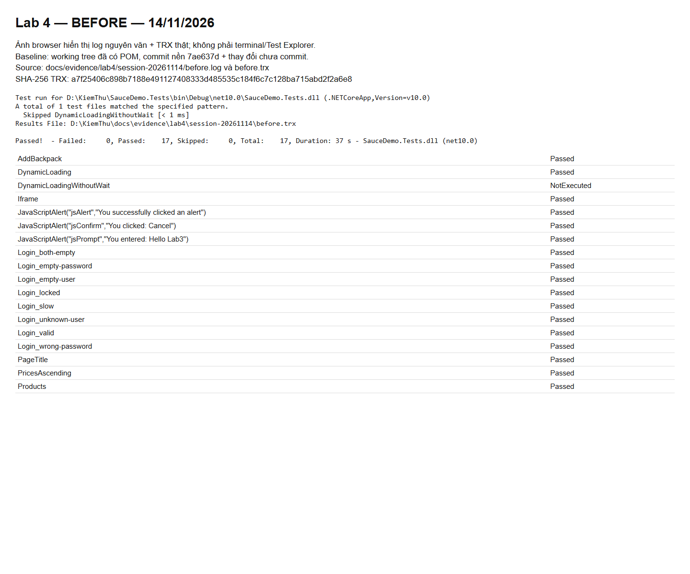
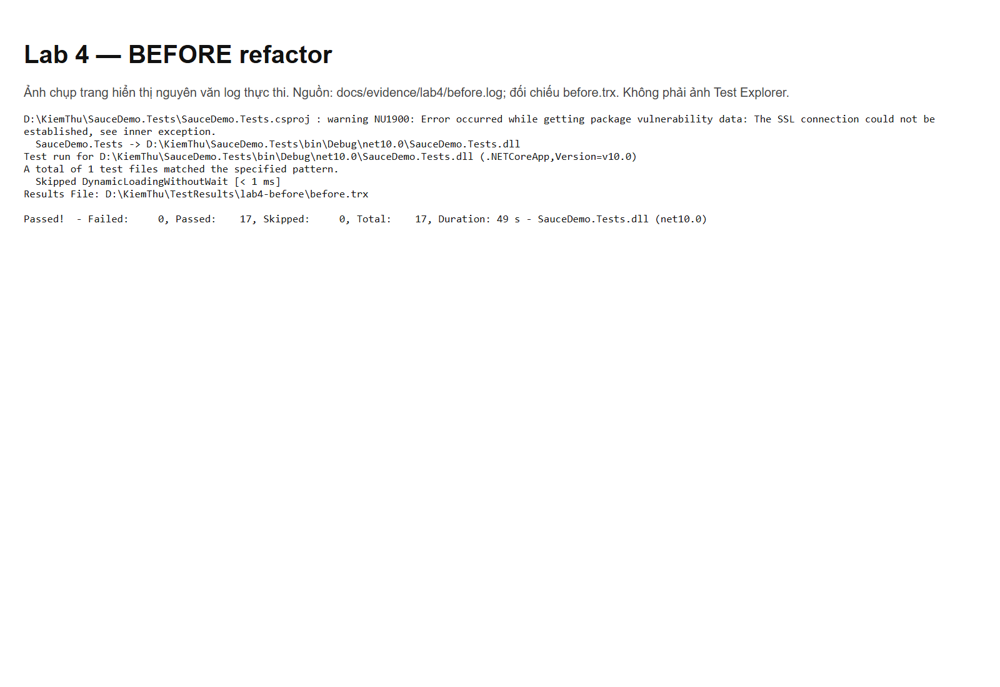
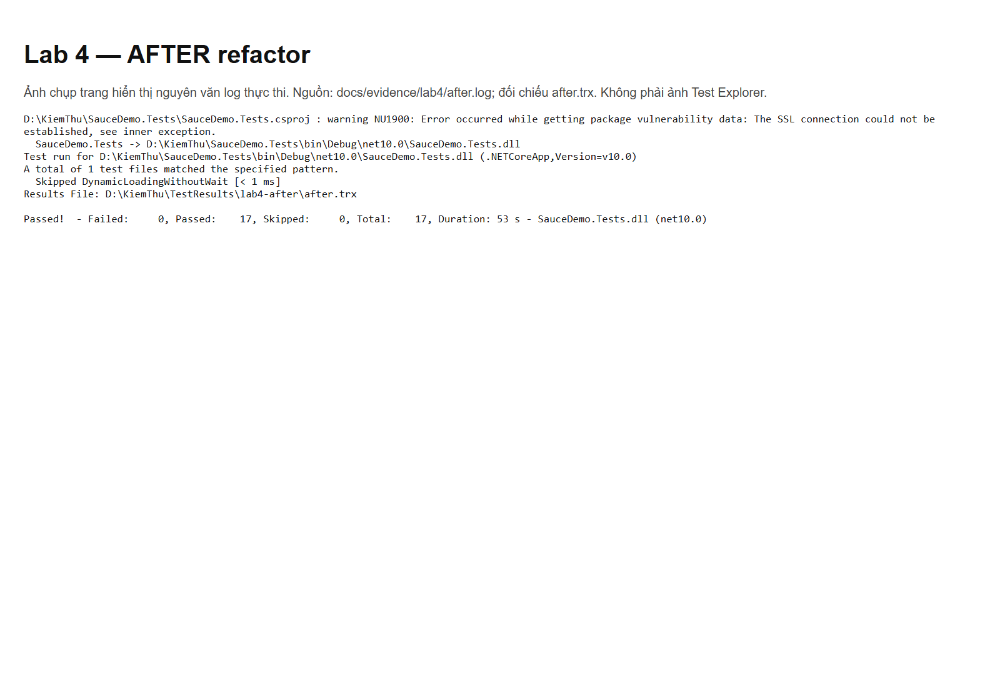


# SauceDemo - NUnit + Selenium

[](https://github.com/phuongvhn2009/KiemThu/actions/workflows/tests.yml)

Framework kiểm thử đăng nhập và giỏ hàng SauceDemo cho ASM kiểm thử nâng cao cùng AI. C#/.NET 10, NUnit 4, Selenium 4, POM, explicit wait, dữ liệu JSON. Local dùng **Cốc Cốc**; CI dùng Chrome headless.

## Cài đặt và chạy (PowerShell)

Cần .NET SDK 10, Cốc Cốc và mạng tới NuGet/SauceDemo. ChromeDriver phải cùng major Chromium với Cốc Cốc (máy kiểm chứng: 154.0.8037.106, driver 154.0.8037.92).

```powershell
git clone https://github.com/phuongvhn2009/KiemThu.git
cd KiemThu
dotnet restore SauceDemo.Tests
$env:TEST_ARTIFACTS = "$PWD/TestResults/artifacts"
# Nếu Manager không nhận diện Cốc Cốc: trỏ tới thư mục driver tương thích đã tải.
$env:CHROMEDRIVER_DIRECTORY = "$env:USERPROFILE/.cache/selenium/chromedriver/win64/154.0.8037.92"
dotnet test SauceDemo.Tests --logger "trx;LogFileName=tests.trx" --results-directory TestResults
```

Chỉ đặt CHROMEDRIVER_DIRECTORY khi thư mục tồn tại; đổi phiên bản theo máy. Bỏ biến để Selenium Manager tự tải. Cốc Cốc ở vị trí khác: đặt CHROME_BINARY tới browser.exe. Mặc định Windows tìm Program Files/CocCoc/Browser/Application/browser.exe. CI/Linux: TEST_BROWSER=chrome, không đặt đường dẫn Windows.

## Cấu hình và cấu trúc

appsettings.json chứa BaseUrl HTTPS, Browser (coccoc/chrome), TimeoutSeconds dương, Headless. TEST_BROWSER ghi đè browser; CHROME_BINARY ghi đè executable. Selenium tạo profile tạm riêng.

```text
SauceDemo.Tests/
  Framework/   Settings, BaseTest (driver/log/screenshot)
  Pages/       BasePage, LoginPage, InventoryPage, CartPage
  Tests/       LoginTests, CartTests
  Data/        login.json (8 ca)
.github/workflows/tests.yml
docs/          báo cáo, thẩm định AI và TRX minh chứng
screenshots/   ảnh lỗi thực tế
```

10 test: tiêu đề, 8 ca login thường/biên/lỗi, thêm Backpack vào giỏ và kiểm tra tên/số lượng. Hai fixture song song, driver riêng từng test. Log theo test; ảnh lỗi khi driver đã mở được. TRX tạo bằng --logger trx. CI upload artifact test-evidence kể cả khi lỗi. Không đặt TEST_ARTIFACTS thì log/ảnh ở artifacts trong NUnit WorkDirectory (thường thư mục build).

## POM và minh chứng

Đổi id nút login chỉ cần sửa field submit trong LoginPage; 8 ca dữ liệu không đổi. CartPage chờ locator thuộc cart-list tránh đọc Inventory khi chuyển trang. BasePage chờ hiển thị/khả dụng; test performance_glitch_user kiểm tra chuyển trang chậm.


[PR #1](https://github.com/phuongvhn2009/KiemThu/pull/1) · [Thẩm định AI](docs/ai-review.md) · [Báo cáo](docs/report.md) · [TRX](docs/evidence/)

GitHub Actions bị khóa bởi billing tài khoản: job chưa chạy, badge đỏ không chứng minh test sai. Sau khi gỡ khóa cần chạy lại và kiểm tra xanh. Pin repo/bio/avatar GitHub cần chủ tài khoản lựa chọn; chưa ghi nhận đã hoàn thiện.

Dữ liệu login là tài khoản demo công khai SauceDemo. Không đưa token, credential hay dữ liệu cá nhân lên repo. Báo cáo ghi rõ phần đã kiểm chứng và phần còn thiếu.

## Lab 1–3 tích hợp

Repo duy nhất: https://github.com/phuongvhn2009/KiemThu. Xem [bảng đối chiếu](docs/lab-requirements.md). Một project SauceDemo.Tests, giữ POM, JSON login và explicit wait.

- Lab 1: PageTitle in và kiểm tra Swag Labs; BaseTest đóng và Dispose driver.
- Lab 2: Authenticate kiểm tra URL inventory.html hoặc đúng thông báo lỗi; Products lấy 6 sản phẩm bằng item.FindElement, in tên–giá, kiểm tra tên không rỗng, tiền tố $ và Backpack.
- Lab 3: PricesAscending dùng SelectElement, decimal và Assert thứ tự; DynamicLoading, JavaScriptAlert, Iframe dùng the-internet.herokuapp.com. DynamicLoadingWithoutWait là ca Explicit cố ý rớt, chạy riêng.

```powershell
dotnet test SauceDemo.Tests --logger 'trx;LogFileName=labs.trx' --results-directory TestResults/labs
dotnet test SauceDemo.Tests --filter 'Name=DynamicLoadingWithoutWait' --logger 'trx;LogFileName=intentional.trx' --results-directory TestResults/intentional
```

Lệnh thứ hai dự kiến trả mã lỗi và tạo ảnh đính kèm: đó là minh chứng chưa chờ #finish. JavaScript tạo phần tử sau khi trang đã tải xong; Explicit Wait chờ sự xuất hiện nên ca DynamicLoading PASS. Không dùng performance_glitch_user để thay minh chứng này.

### Locator Lab 2

| Phần tử | Chọn | Phương án khác | Lý do |
|---|---|---|---|
| Username | #user-name | [data-test='username'] | id định danh ô nhập |
| Password | #password | [data-test='password'] | id ổn định |
| Login | #login-button | [data-test='login-button'] | id định danh nút |
| Tên Backpack | #item_4_title_link | [data-test='inventory-item'] [data-test='inventory-item-name'] | id cho một sản phẩm; selector thứ hai dùng trong từng item |
| Giá Backpack | [data-test='inventory-item']:first-child [data-test='inventory-item-price'] | .inventory_item:first-child .inventory_item_price | data-test ít phụ thuộc CSS; first-child chỉ dùng kiểm chứng thứ tự mặc định |

Ảnh Ctrl+F và prompt outerHTML/nhận xét AI lịch sử nằm trong báo cáo Lab 2 ở DOCUMENT; chưa chụp lại DevTools cho bản tích hợp. Trong code danh sách, selector tên và giá được giới hạn trong từng item, không yêu cầu selector danh sách khớp duy nhất trên cả trang.

### Ghi nhận AI và bằng chứng mới

AI phát hiện phần còn thiếu bằng đối chiếu PDF với code. Lần chạy đầu: 15 PASS, 2 FAIL. Alert lỗi vì gửi chữ vào hộp thoại không có ô nhập; sửa chỉ SendKeys với Prompt. Iframe trả chuỗi rỗng sau Clear/SendKeys; thay bằng click, Ctrl+A, Delete và chờ nội dung thực tế. Chạy lại verified: 17/17 PASS trong 36 giây. Đây chỉ là một lần chạy; không tuyên bố đã lặp 15–20 lần. Log/TRX ở docs/evidence/labs. Prompt tác vụ tích hợp là yêu cầu người dùng ngày 12/11/2026; các prompt AI gốc của từng lab được giữ trong Word.

NuGet có cảnh báo NU1900 do SSL khi kiểm tra dữ liệu lỗ hổng; không tắt audit. Các trạng thái CI trong phần ASM phía trên là lịch sử, chưa xác minh lại trên GitHub. Không commit/push trong lần tích hợp này.

## Lab 4 — Refactor POM

### Kết quả mới ngày 14/11/2026

Cập nhật lúc hoàn tất: chạy lại restore ngoài sandbox đã tải thành công dữ liệu lỗ hổng NuGet, không tắt audit hay đổi dependency; build cuối **0 warning, 0 error**. NU1900 trong các log trước là kết quả thật của giới hạn SSL trong sandbox. Xem [log restore](docs/evidence/lab4/session-20261114/restore-recheck-unrestricted.log) và [build cuối](docs/evidence/lab4/session-20261114/final-build.log). Người dùng đã yêu cầu tiếp tục commit/push và kiểm tra CI; các câu “chưa commit/push” bên dưới mô tả trạng thái ở thời điểm ghi nhận trước đó.

Nhánh `refactor/lab4-pom`, nền `7ae637d78f16a68c8c67d2de539c6e46e72d569e` **cộng thay đổi chưa commit có sẵn**. Đã đọc lại đề A–E và giữ công việc người dùng. Xem [hồ sơ phiên này](docs/evidence/lab4/session-20261114/README.md) để đối chiếu commit, trạng thái Git, source trước sửa, hash, danh sách test, log, TRX và diff. Không dùng số liệu cũ bên dưới làm baseline mới.

Build trước/sau thành công; bộ thường lệ **17/17 PASS trước và sau**, cùng tên và outcome; Explicit NotExecuted. Ca `DynamicLoadingWithoutWait` chạy riêng FAIL đúng `NoSuchElementException` tại `#finish`. `python Checks/check_lab4.py` PASS, mặc định đọc minh chứng phiên 14/11. Build còn NU1900 do SSL khi audit NuGet.

Đã xác minh A–D: BasePage abstract quản lý Driver/Wait/Tim; locator private readonly; đủ API đăng nhập, inventory và chaining giá; Tests không có By, Pages không có Assert hoặc public API trả IWebElement. Sửa thêm OpenCart trả CartPage và cập nhật caller; chuyển iframe bằng phần tử tìm từ locator chung. Giữ toàn bộ assert cũ, dữ liệu JSON và chức năng Lab 1–3/Assignment.

### Phần E — prompt, kết quả và thẩm định AI

Prompt thực tế là yêu cầu hoàn thiện Lab 4 của người dùng trong phiên này, với quy ước từ đề PDF đã đọc. Các trích đoạn nguyên văn liên quan:

> “Hoàn thiện các phần A–E của Lab 4 trên project SauceDemo.Tests hiện có.”
> “BasePage phải abstract, quản lý driver và WebDriverWait dùng chung.”
> “Có hàm protected Tim(By) tìm phần tử kèm explicit wait.”
> “Giữ nguyên chức năng, dữ liệu và các kiểm tra của Lab 1–3 cùng Assignment.”

Quy ước đối chiếu thêm từ đề: locator private readonly By; không Assert trong Page; không By trong Tests; hành vi chuyển trang trả Page mới; không trả IWebElement qua API public. Đây là bản ghi prompt và tiêu chí đã dùng, không dựng thêm cuộc trò chuyện AI khác.

Kết quả Codex trả về trong phiên này là [diff code thực tế](docs/evidence/lab4/session-20261114/session-code.diff): refactor CartTests trong UiTests.cs để nhận `var cart = inventory.OpenCart();`, InventoryPage.OpenCart trả CartPage, LabPage chuyển frame bằng `Tim(frame)`. Assert tên Backpack/số lượng và iframe giữ nguyên. Những thay đổi POM lớn khác đã có trước phiên và được kiểm tra lại, không nhận là đầu ra mới.

Chỗ AI chưa đúng quy ước trong bản có sẵn: `OpenCart()` trả void, test tự `new CartPage(...)`; việc chuyển sang Page mới chưa được mô hình hóa tại hành vi chuyển trang theo hướng dẫn đề. Đã sửa Page và caller. Iframe còn lặp ID chuỗi dù có locator private readonly, đã dùng trực tiếp phần tử từ Tim(frame). Nhận xét cũ “Assert còn trong LabPage” và “By còn trong test iframe” **không còn đúng ở source đầu phiên**; không nhận công sửa lỗi đã hết.

Kiểm chứng: đọc caller, rà quy ước Pages/Tests và assert, so sánh mapping tên/outcome của hai TRX; hash xác nhận Framework/Data/config/dependency không đổi; chạy riêng Explicit để giữ minh chứng lỗi đồng bộ. Không nới assert để ép xanh.




Hai ảnh trên là browser chụp trang hiển thị log nguyên văn và dữ liệu TRX phiên này, có nguồn/hash; không giả giao diện terminal/Test Explorer. Ảnh browser từ các test có attachment cũng nằm trong hồ sơ phiên. Không tạo Word, sửa form tài liệu hay triển khai Checkout. Chưa kiểm tra CI, chưa commit/push công việc có sẵn.

### Ghi nhận cũ có sẵn khi bắt đầu phiên

[Phân tích, đối chiếu từng tiêu chí, API, thẩm định AI và bằng chứng Lab 4](docs/lab4.md).

- BasePage abstract giữ Driver và WebDriverWait; Tim(By) tìm phần tử kèm explicit wait. Page con kế thừa, locator private readonly.
- Login.DangNhap trả InventoryPage; LayThongBaoLoi giữ luồng login sai. InventoryPage có DaHienThi, SapXep(value) trả this và LayDanhSachGia trả IReadOnlyList<decimal>.
- Test sắp xếp dùng `Login.DangNhap(...).SapXep("lohi").LayDanhSachGia()`, vẫn kiểm tra đủ 6 giá và Is.Ordered.Ascending.
- Tests không còn chữ By; Pages không có Assert và không trả IWebElement qua API public. Nội dung alert được Assert ở test trước khi đóng; iframe được kiểm tra qua Page.
- Trước: 17/17 PASS (49 giây). Sau: cùng 17/17 PASS (53 giây). Explicit không chờ vẫn rớt riêng đúng NoSuchElementException. Log/TRX ở [docs/evidence/lab4](docs/evidence/lab4/); kiểm tra tự động: `python Checks/check_lab4.py`.
- Thẩm định AI: code trước có Assert trong LabPage và By trong test iframe, đã chuyển về đúng trách nhiệm; bản nháp có nullable warning ở alert đã sửa. Prompt và phân tích chi tiết nằm trong tài liệu Lab 4.

Ảnh dưới là ảnh chụp trang hiển thị log thực thi nguyên văn, không phải Test Explorer; đối chiếu được với TRX kèm theo.



